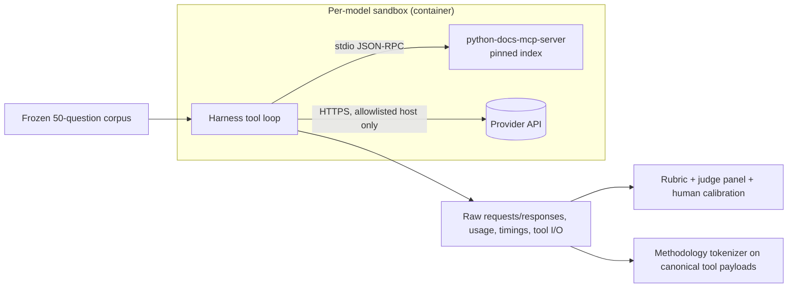

# Multi-LLM MCP Benchmarking: Provider APIs, Sandboxing, Methodology

**Date:** 2026-10-25
**Status:** Research notes. These notes do not change the accepted
methodology in `docs/benchmarks/PUBLIC-BENCHMARK-METHODOLOGY.md`. They do not
authorize paid calls or public claims (see issue #63 and decision 5.17).
**Scope:** How to benchmark `python-docs-mcp-server` against several LLMs
called through their **APIs** (Anthropic Claude, OpenAI GPT/Codex, Google
Gemini Flash, Google Gemma), with each model run in its own sandbox.

Every factual claim links to its source. Statements marked **(inferred)** are
my reasoning from the cited sources, not something a source states.
Provider facts were checked on 2026-10-25. Model IDs and API features change
often, so re-check them on the day of any live run.

---

## TL;DR

1. **Use a client-side harness.** Open one MCP stdio session, convert its tool
   list into each provider's function-calling format, and run the tool loop
   yourself. This is the only path that covers all four model families. It
   keeps the tool schemas, tool results, timing and token accounting under
   your control.
   - Provider-hosted MCP exists for Anthropic, OpenAI and Gemini, but it only
     reaches remote HTTP servers. This server is stdio-only today. Gemma has no
     hosted MCP at all. See [section 2](#2-provider-native-mcp-support-via-api).
2. **Current model IDs differ from `model-matrix.yml`.**
   - OpenAI: `gpt-4o` and `gpt-4o-mini` are deprecated.
   - Google: `gemini-1.5-*` is no longer listed. The Flash model the user
     called "Flash 3.8" is real: `gemini-3.8-flash`, stable since 2026-09-02.
   - Gemma: Gemma 4 is on the Gemini API as `gemma-4-31b-it` and
   `gemma-4-26b-a4b-it`, free tier only.
   - OpenAI has no current Codex-only API model. Codex recommends
     `gpt-6.1-sol`, `gpt-6-luna` and `gpt-6-astra`.
3. **You cannot use temperature 0 as a control on most of these models.**
   - Claude 5.5 models return HTTP 400 if you send `temperature`.
   - OpenAI reasoning models reject it unless effort is `none`.
   - Google advises against lowering temperature on Gemini 3.

   Use repeated runs (epochs) and confidence intervals instead.
4. **Sandbox the harness and the MCP server, not the model.** Hosted models
   run at the provider. Use one container per model run, built from a pinned
   image with `uv sync --locked`. Give it only that provider's API key and an
   egress allowlist that admits only that provider's API host. Give it a
   throwaway HOME and a read-only root filesystem. Self-hosted Gemma (vLLM)
   is the only case where the model itself runs inside your sandbox.
5. **Framework:** Inspect AI fits best if you adopt a framework. It runs MCP
   stdio servers client-side, supports all three providers plus vLLM, and
   creates a sandbox per sample. It also has epochs, clustered standard
   errors, CIs and a majority-vote panel of LLM graders. If you would rather
   avoid the dependency, write a thin loop on the official SDKs.
   - Skip the OpenAI Evals platform: it shuts down on 2026-11-30.
   - Use LiteLLM only if pinned exactly. Releases 1.82.7 and 1.82.8 shipped
     credential-stealing malware.

---

## 0. Repo context (spot observations, not an audit)

- Issue #63 is the benchmark umbrella. The methodology is accepted, the corpus
  has 50 frozen questions, and plumbing exists. The live provider adapters
  still raise `LiveExecutionNotImplementedError`. `PythonDocsMcpAdapter`
  returns retrieved docs, not a model-generated answer. Source: the triage
  comment on `gh issue view 63` and `benchmarks/adapters/base.py`.
- The current methodology is **retrieve-then-answer**. Its rule: "Every system
  under test receives the same user question. The only allowed difference is
  the documentation context supplied by that system." Source:
  `docs/benchmarks/PUBLIC-BENCHMARK-METHODOLOGY.md`. An agentic mode, where
  the model chooses which tools to call, changes that invariant to "only the
  tool set differs". That change needs a methodology amendment **(inferred)**.
- The server runs only over stdio. `mcp_server.run(transport="stdio")` is in
  `src/mcp_server_python_docs/__main__.py`.
- Two tools depend on the environment. Both matter inside a sandbox:
  - `detect_python_version` reads `.python-version` in the working directory,
    then `python3 --version`, then the server's own runtime. Source:
    `src/mcp_server_python_docs/detection.py`.
  - `lookup_package_docs` calls `https://pypi.org/pypi/<project>/json`.
    Source: `src/mcp_server_python_docs/services/package_docs.py`.

  The corpus is stdlib-only. Allowlist only the stdlib tools for the
  benchmark, or pin the working directory and interpreter **(inferred)**.
- `model-matrix.yml` lists `gpt-4o-mini`, `gpt-4o`, `gemini-1.5-flash` and
  `gemini-1.5-pro`:
  - OpenAI marks `gpt-4o` and `gpt-4o-mini` "Deprecated"
    ([OpenAI all models](https://developers.openai.com/api/docs/models/all)).
  - The Gemini models page no longer lists `gemini-1.5-*`
    ([Gemini models](https://ai.google.dev/gemini-api/docs/models)).
- `benchmarks/adapters/claude_tokens.py` sets
  `DEFAULT_COUNT_MODEL = "claude-3-5-sonnet-20241022"`. That model was retired
  on 2025-10-28
  ([Anthropic deprecations](https://platform.claude.com/docs/en/about-claude/model-deprecations)).
  Token counting supports "all active models"
  ([token counting](https://platform.claude.com/docs/en/build-with-claude/token-counting)),
  so a live count with that default will likely fail **(inferred)**.
  - Claude 4.7 and later use a newer tokenizer. It produces about 30% more
    tokens for the same text (same source).
  - The count model is therefore part of the methodology. Pin it and record
    it **(inferred)**.

---

## 1. Model IDs to use (verified 2026-10-25)

| Family | Recommended ID(s) | Notes | Source |
|---|---|---|---|
| Anthropic | `claude-sonnet-5-5` (primary), `claude-haiku-5-5`, `claude-opus-5-5` | Pinned snapshot IDs with no date suffix. All have 1M context. Price per MTok (input/output): Sonnet 5.5 $2/$10, Opus 5.5 $4/$20, Haiku 5.5 "from" $0.10/$0.50. | [Models overview](https://platform.claude.com/docs/en/about-claude/models/overview) |
| OpenAI | `gpt-6.1-sol` (balanced), `gpt-6-luna` (cost-sensitive), `gpt-6-astra` (flagship) | Responses API. Luna also supports reasoning effort `none`. `gpt-4o*` and `gpt-5`/`-mini`/`-nano` are deprecated. | [Models](https://developers.openai.com/api/docs/models), [All models](https://developers.openai.com/api/docs/models/all) |
| OpenAI "Codex" | Same models as above | Codex recommends `gpt-6.1-sol`, `gpt-6-luna` and `gpt-6-astra`. `gpt-5.3-codex` is deprecated. Older `*-codex` models are shut down. | [Codex models](https://learn.chatgpt.com/docs/models), [All models](https://developers.openai.com/api/docs/models/all) |
| Gemini Flash | `gemini-3.8-flash` | Stable. Released 2026-09-02. 1,048,576 input and 65,536 output tokens. Thinking levels `low`/`medium`/`high`; `minimal` returns an error. Paid tier: $0.75 in / $3.75 out per MTok through 2026-12-31, doubling on 2027-01-01. | [Changelog](https://ai.google.dev/gemini-api/docs/changelog), [Model card](https://ai.google.dev/gemini-api/docs/models/gemini-3.8-flash), [Pricing](https://ai.google.dev/gemini-api/docs/pricing) |
| Gemma | `gemma-4-31b-it`, `gemma-4-26b-a4b-it` (Gemini API) | Released on the Gemini API on 2026-04-02. Pricing lists a free tier only; paid tier is "Not available". Free-tier content is "Used to improve our products: Yes". | [Changelog](https://ai.google.dev/gemini-api/docs/changelog), [Gemma on Gemini API](https://ai.google.dev/gemma/docs/core/gemma_on_gemini_api), [Pricing](https://ai.google.dev/gemini-api/docs/pricing) |

Reproducibility hazards:

- Google redirects deprecated IDs to newer models automatically. Example from
  2026-10-08: "`gemini-3.7-flash` is deprecated and has been replaced by
  `gemini-3.8-flash`." Requests to 3.7 are routed to 3.8
  ([changelog](https://ai.google.dev/gemini-api/docs/changelog)).
  - Record the model version each response reports, not only the requested
    ID **(inferred)**.
- Gemini rate limits are set per project and shown in AI Studio, not as
  fixed public numbers
  ([rate limits](https://ai.google.dev/gemini-api/docs/rate-limits)).

---

## 2. Provider-native MCP support via API

### 2.1 Summary

| Provider | Hosted MCP in API | Local stdio? | Client-side bridge possible? | Token reporting |
|---|---|---|---|---|
| Anthropic | Yes: Messages API `mcp_servers` + `mcp_toolset`, beta header `mcp-client-2025-11-20` (`mcp-client-2026-09-15` adds tool-list pinning). Tools only. | **No.** "Local STDIO servers cannot be connected directly." | Yes. SDK helper `async_mcp_tool` + `tool_runner`. | `usage.input_tokens`, `output_tokens`, `cache_creation_input_tokens`, `cache_read_input_tokens`, `output_tokens_details.thinking_tokens` |
| OpenAI | Yes: Responses API tool `{"type": "mcp", ...}` with `server_url`, or `tunnel_id` through Secure MCP Tunnel | Only through Secure MCP Tunnel (`tunnel-client --mcp-command`) | Yes. Plain function tools; Agents SDK `MCPServerStdio`. | `usage.input_tokens`, `input_tokens_details.cached_tokens`/`cache_write_tokens`, `output_tokens`, `output_tokens_details.reasoning_tokens`, `total_tokens` |
| Gemini | Interactions API tool `{"type": "mcp_server", ...}`, Streamable HTTP only. Interactions API is beta, and one doc page says Gemini 3 does not support remote MCP yet. The python SDK has **experimental** support for passing a local MCP `ClientSession` as a tool. | Through the python SDK's experimental `tools=[session]` | Yes. Disable automatic function calling and run a manual loop. | `usage_metadata.prompt_token_count`, `candidates_token_count`, `cached_content_token_count`, `thoughts_token_count`, `tool_use_prompt_token_count`, `total_token_count` |
| Gemma | No hosted MCP | Not applicable | Yes. Function declarations on the Gemini API, or native tool tokens with self-hosted vLLM (`--tool-call-parser gemma4`). | Same Gemini `usage_metadata` when called through the Gemini API (inferred); vLLM returns OpenAI-style usage (inferred) |

### 2.2 Anthropic: MCP connector (Messages API)

- **Shape.** Put server details (URL, auth) in an `mcp_servers` array. Put an
  `mcp_toolset` entry in `tools` to allowlist, denylist or configure tools.
  - Beta header: `mcp-client-2025-11-20`. The older `mcp-client-2025-04-04` is
    deprecated.
  - Source: [MCP connector](https://platform.claude.com/docs/en/agents-and-tools/mcp-connector).
- **Limitations.** "Only tool calls are currently supported." Also: "The server
  must be publicly exposed through HTTP (supports both Streamable HTTP and SSE
  transports). Local STDIO servers cannot be connected directly." (same page)
- **Response blocks.**
  - `mcp_tool_use` and `mcp_tool_result`.
  - With header `mcp-client-2026-09-15`, an `mcp_tool_listing` block records
    each server's tool list. The list can be pinned, so a server that changes
    its tools mid-conversation does not change what Claude sees (same page).
- **Not covered by ZDR.** "Data exchanged with MCP servers, including tool
  definitions and execution results, is retained according to Anthropic's
  standard data retention policy." (same page)
- **No exact token counts.** The token-counting endpoint returns
  `invalid_request_error` for requests that use the MCP connector. For those,
  only the `usage` of the real Messages call reports tokens
  ([token counting](https://platform.claude.com/docs/en/build-with-claude/token-counting)).
  - That conflicts with this repo's token method, which counts with Claude
    after client rewrap **(inferred)**.
- **Client-side alternative (documented).** For "local servers, prompts,
  resources, or more control", the SDK ships helpers:
  - Install: `pip install "anthropic[mcp]"`.
  - `from anthropic.lib.tools.mcp import async_mcp_tool` turns MCP tools into
    Claude tools for `client.beta.messages.tool_runner(...)`.
  - The documented example uses `mcp.client.stdio.stdio_client`
    ([MCP connector, client-side helpers](https://platform.claude.com/docs/en/agents-and-tools/mcp-connector)).
- **Request constraints that affect a benchmark** (Claude 5.5):
  - Setting `temperature`, `top_p` or `top_k` returns HTTP 400.
  - `tool_choice` `any` or `tool` (forced tool use) is rejected on Opus 5.5.
  - Adaptive thinking is always on, steered by `effort` (`low` … `max`).
  - Sources: [Opus 5.5 migration guide](https://platform.claude.com/docs/en/models/opus-5-5/migration-guide),
    [Sonnet 5.5](https://platform.claude.com/docs/en/models/sonnet-5-5/overview),
    [Haiku 5.5](https://platform.claude.com/docs/en/models/haiku-5-5/overview).
- **Usage reporting.**
  - "Total input tokens in a request is the summation of `input_tokens`,
    `cache_creation_input_tokens`, and `cache_read_input_tokens`."
  - `output_tokens_details.thinking_tokens` splits out reasoning.
  - Counts "will not match one-to-one with the exact visible content".
  - Source: [Messages API reference](https://platform.claude.com/docs/en/api/messages/create).
  - Any `tools` request also adds a hidden "tool use system prompt", with a
    token count that varies by model
    ([pricing](https://platform.claude.com/docs/en/about-claude/pricing)).

### 2.3 OpenAI: Responses API MCP tool

- **Shape.** `"type": "mcp"` with `server_label`, then either `server_url`
  (remote) or `tunnel_id` (local, through Secure MCP Tunnel). Optional fields:
  `allowed_tools`, `require_approval` (`"always"`/`"never"`/object),
  `authorization`, `defer_loading`.
  - Output items: `mcp_list_tools`, `mcp_call`, `mcp_approval_request`.
  - Transport: "works with remote MCP servers that support either the
    Streamable HTTP or the HTTP/SSE transport protocols."
  - Source: [MCP and connectors guide](https://developers.openai.com/api/docs/guides/tools-connectors-mcp).
- **Billing.** You pay only for the tokens used to import tool definitions and
  make tool calls; "No additional fees apply per tool call."
  - The tool list is not refetched while `mcp_list_tools` stays in context.
  - With `store=true`, data sent to MCP servers is logged for 30 days unless
    ZDR is enabled.
  - Which models support it is listed per model.
  - Source: same page. The flagship model pages I read listed "Functions, Web
    search, File search, Computer use" but no MCP. Confirm at run time
    ([models](https://developers.openai.com/api/docs/models)).
- **Local stdio through Secure MCP Tunnel.** `tunnel-client` runs in your
  network, opens outbound HTTPS to `api.openai.com:443` and long-polls for MCP
  requests. It forwards each request to "the configured stdio command or MCP
  server URL".
  - Setup: `tunnel-client init --tunnel-id ... --mcp-command "python ..."`.
  - Default limits: 600 requests/minute, 10 MiB per message, 120 s deadline.
  - Source: [Secure MCP Tunnel](https://developers.openai.com/api/docs/guides/secure-mcp-tunnels).
  - This adds an OpenAI-only network path with its own latency. That breaks
    symmetry with the other providers **(inferred)**.
- **Client-side alternative.** Plain function tools.
  - "functions are injected into the system message … billed as input
    tokens" ([function calling](https://developers.openai.com/api/docs/guides/function-calling)).
  - Strict mode needs `additionalProperties: false` and every property in
    `required`.
  - If `strict` is omitted, the Responses API "will attempt to normalize your
    schema into strict mode when possible". Set `strict` explicitly and record
    it, so the tool schemas you send are known (same page).
- **Sampling.** The Responses `create` reference has `temperature` and `top_p`
  but no `seed`
  ([reference](https://developers.openai.com/api/reference/resources/responses/methods/create)).
  For reasoning models: "When reasoning effort is not `none`, remove
  `temperature`, `top_p`, and `top_logprobs`"
  ([latest-model guide](https://developers.openai.com/api/docs/guides/latest-model)).
- **Usage reporting.** `usage.input_tokens`,
  `input_tokens_details.{cached_tokens, cache_write_tokens}`, `output_tokens`,
  `output_tokens_details.reasoning_tokens`, `total_tokens`
  ([reference](https://developers.openai.com/api/reference/resources/responses/methods/create)).
- `max_tool_calls` caps **built-in** tool calls only, not your own function
  tools (same reference). The harness must enforce its own turn cap
  **(inferred)**.

### 2.4 Google Gemini: Interactions API and the google-genai SDK

- **Hosted remote MCP.** Tools list entry `"type": "mcp_server"` with `name`
  and `url`; optional `headers` and `allowed_tools`. "Remote MCP only works
  with Streamable HTTP servers. SSE … servers are not supported."
  ([function calling](https://ai.google.dev/gemini-api/docs/function-calling)).
  - The Interactions API page lists limitations: "beta/preview", "breaking
    changes may occur", and "Gemini 3 does not support remote MCP, this is
    coming soon."
  - It also says: "For production workloads, you should continue to use the
    standard `generateContent` API."
    ([Interactions API](https://ai.google.dev/gemini-api/docs/interactions)).
  - Treat hosted MCP on Gemini as unstable for a benchmark **(inferred)**.
- **SDK MCP (experimental).** The `google-genai` README says built-in MCP
  support "is an experimental feature. You can pass a local MCP server as a
  tool directly."
  - Example: `config=GenerateContentConfig(tools=[session])`, where `session`
    is an `mcp.ClientSession` over `stdio_client`. The SDK then calls the tool
    through automatic function calling.
  - Source: [python-genai README](https://github.com/googleapis/python-genai/blob/main/README.md),
    SDK v2.33.0 released 2026-10-22.
  - Automatic function calling hides the loop. For measurement, disable it
    with `automatic_function_calling=types.AutomaticFunctionCallingConfig(disable=True)`
    (same README) and run the loop yourself **(inferred)**.
- **Thought signatures.** Gemini 3 models return thought signatures, which
  must be preserved across turns. The SDKs handle this automatically. For a
  stateless manual loop, pass back every model-generated step "exactly as
  received"
  ([function calling](https://ai.google.dev/gemini-api/docs/function-calling),
  [thinking](https://ai.google.dev/gemini-api/docs/thinking)).
- **Function-calling modes.** `auto`, `any`, `none`, `validated`. "Only a
  subset of the OpenAPI schema is supported." Keep the active tool set to
  "10-20 tools maximum"
  ([function calling](https://ai.google.dev/gemini-api/docs/function-calling)).
- **Temperature.** "For all Gemini 3 models, we strongly recommend keeping the
  temperature parameter at its default value of `1.0`". Lower values "may lead
  to unexpected behavior, such as looping or degraded performance"
  ([Gemini 3 guide](https://ai.google.dev/gemini-api/docs/gemini-3)).
  - `GenerateContentConfig` does have a `seed` field
    ([types.py](https://github.com/googleapis/python-genai/blob/main/google/genai/types.py)).
- **Usage reporting** (`GenerateContentResponseUsageMetadata`):
  - Fields: `prompt_token_count`, `candidates_token_count`,
    `cached_content_token_count`, `thoughts_token_count`,
    `tool_use_prompt_token_count`, and `total_token_count`.
  - `tool_use_prompt_token_count` is "tokens in the results from tool
    executions, which are provided back to the model as input".
  - `total_token_count` is the sum of prompt, candidates, tool-use-prompt and
    thoughts counts.
  - Source: [types.py](https://github.com/googleapis/python-genai/blob/main/google/genai/types.py).
  - The tool-use field likely fills only for server-executed tools. With a
    client loop, your tool results show up in `prompt_token_count` on the
    next turn **(inferred)**.

### 2.5 Gemma

- **Gemini API.** `gemma-4-31b-it` and `gemma-4-26b-a4b-it`.
  - Function calling uses the same `function_declarations`.
  - `system_instruction` is supported. Thinking is set with `thinking_config`
    ("high" or "minimal").
  - Source: [Gemma on Gemini API](https://ai.google.dev/gemma/docs/core/gemma_on_gemini_api).
    That page says it is deprecated in favor of [gemma.ai](https://gemma.ai).
  - Pricing: free tier only, and free-tier content may be used to improve
    Google products ([pricing](https://ai.google.dev/gemini-api/docs/pricing)).
  - Contamination and terms risk: the benchmark prompts and answers could be
    used to improve future models **(inferred)**.
- **Native tool calling.** The Gemma 4 chat template marks tools with special
  tokens such as `<|tool>declaration:...<tool|>` and `<|tool_call>call:...<tool_call|>`
  ([Gemma function calling](https://gemma.ai/get-started/capabilities/function-calling/)).
  - Gemma 4 variants: E2B, E4B, 12B, 26B A4B (MoE) and 31B (dense). Small
    models have a 128K context window, medium models 256K
    ([Gemma 4](https://gemma.ai/models/gemma-4/)).
- **Self-hosting.** vLLM serves it with
  `--enable-auto-tool-choice --tool-call-parser gemma4`
  ([vLLM gemma4 parser](https://docs.vllm.ai/en/latest/api/vllm/tool_parsers/gemma4_tool_parser/)).
  - Gemma 4 is also in Vertex AI Model Garden
    ([Gemma on Vertex](https://ai.google.dev/gemma/docs/integrations/vertex)).
  - A third-party report says Gemma 4 sometimes writes tool calls as plain
    text under long prompts with many tools
    ([vllm-mlx parser](https://vllm-mlx.is-a.dev/reference/api/vllm_mlx/tool_parsers/gemma4_tool_parser/),
    secondary).
  - Self-hosting with pinned weights (Hugging Face revision) and a pinned
    vLLM image is the only setup here where the **model itself** runs in your
    sandbox. It is also the only fully reproducible one. It needs a GPU
    **(inferred)**.

### 2.6 MCP spec note

- The latest spec revision is `2026-07-28`
  ([spec](https://modelcontextprotocol.io/specification/latest)). It defines
  two standard transports:
  - stdio: "newline-delimited messages over the standard streams of a
    client-launched subprocess".
  - Streamable HTTP.
- Earlier revisions used a connection-scoped `initialize` handshake. Peers
  detect each other's era and fall back
  ([transports](https://modelcontextprotocol.io/specification/2026-07-28/basic/transports)).
- This repo locks `mcp==1.30.0` (`uv.lock`). PyPI's latest `mcp` is 2.3.0.
  Pin the harness's MCP client version and record it, because the client
  version is part of the system under test **(inferred)**.

---

## 3. Recommended architecture

### 3.1 Client-side bridge (recommended)

Loop design. All items are **(inferred)**; they follow from the sources in
section 2.

1. Start the MCP server once per sandbox and call `tools/list`. Store the
   exact tool schemas and their hash.
2. Convert each MCP tool into the provider's format:
   - Anthropic: `tools[]` with `input_schema`.
   - OpenAI: `{"type":"function", ..., "strict": <explicit>}`.
   - Gemini and Gemma: `function_declarations`, after reducing the schema to
     the OpenAPI subset Gemini accepts.

   Store each converted schema and its hash. The converted schemas are what
   each model actually saw.
3. Run the loop with `tool_choice=auto` for every provider. Opus 5.5 rejects
   forced tool use, so `auto` is the only fair common setting.
   - Use a hard turn cap (example: 8 model calls).
   - Use a tool-call cap and a per-call timeout.
   - Set a byte cap on tool results and apply it the same way for every
     provider.
4. Turn each MCP `CallToolResult` into one canonical text string, the same for
   every provider. Hash it, then wrap it in the provider's tool-result shape.
5. Record the raw provider usage object verbatim on every turn. Record wall
   time per model call and per tool call. If streaming, also record time to
   first token.
6. **No-MCP baseline:** the same loop and system prompt with zero tools.
   **Each competitor:** the same loop pointed at that competitor's MCP. Remote
   competitors connect through the MCP SDK's Streamable HTTP client.

Why this beats provider-hosted MCP for this benchmark:

- **Coverage.** Hosted MCP needs a publicly reachable HTTP server. Anthropic
  says so explicitly; OpenAI and Gemini require HTTP unless you use the OpenAI
  tunnel. This server is stdio-only, and Gemma has no hosted MCP (section 2).
- **Symmetry.** All models see the same canonical tool payloads, and tool
  latency is measured on the same host. With hosted MCP, each provider's
  data centre calls your server over a different path **(inferred)**.
- **Token method.** Anthropic's count endpoint rejects MCP-connector requests
  ([token counting](https://platform.claude.com/docs/en/build-with-claude/token-counting)).
  The client-side path keeps the repo's "Claude tokens after client rewrap"
  method possible.
- **Observability.** Inspect AI notes that with remote (provider-run) MCP,
  Inspect "cannot see or approve" the tool calls
  ([Inspect MCP](https://inspect.aisi.org.uk/tools-mcp.html)). The same is
  true of any harness **(inferred)**.
- **Data handling.** Anthropic's MCP connector is outside ZDR
  ([MCP connector](https://platform.claude.com/docs/en/agents-and-tools/mcp-connector)).

When hosted MCP is still worth running:

- As an optional, clearly labelled secondary arm that asks "does this server
  work in the provider's native connector?" Run it through a public
  Streamable HTTP deployment. Report it separately and never mix it into the
  headline numbers **(inferred)**.

### 3.2 Two benchmark modes

| Mode | What varies | Measures | Fit with current methodology |
|---|---|---|---|
| **A. Fixed retrieval** (current repo design) | Retrieved context only. Each system's retrieval runs deterministically; the model answers in one call. | Quality of retrieved content | Already accepted. The live provider calls are still missing. |
| **B. Agentic tool use** | Tool set only. The model decides when and how to call tools. | End-to-end MCP effectiveness, including tool choice, query wording and call count | Needs a methodology amendment **(inferred)** |

The user asked how effective the MCP is with real LLMs, which is mode B.
Mode A is a cleaner control for content quality. Report both, labelled
separately **(inferred)**.

---

## 4. Sandboxing per model

### 4.1 What existing benchmarks do

| Project | Isolation pattern | Evaluation | Source |
|---|---|---|---|
| **MCPMark** | Docker or local runs; per-task "curated initial state" with programmatic verification; MCP server versions pinned; "MCPMark Verified" pins every environment version | Script verifiers; pass@k, pass^k, avg@k; minimal tool-calling loop; depends on `litellm==1.80.0` | [repo](https://github.com/eval-sys/mcpmark), [paper](https://arxiv.org/abs/2509.24002), [pyproject](https://github.com/eval-sys/mcpmark/blob/main/pyproject.toml) |
| **MCP-Universe** | Docker for Dockerized MCP servers; providers chosen per config (`type: openai/anthropic/google`) | Execution-based evaluators (format, static, dynamic), no LLM judge | [repo](https://github.com/SalesforceAIResearch/MCP-Universe), [paper](https://arxiv.org/abs/2508.14704) |
| **MCP-Bench** | Live MCP servers; models through OpenRouter or Azure | LLM judge, with o4-mini hard-coded "to reproduce the results" | [repo](https://github.com/Accenture/mcp-bench), [paper](https://arxiv.org/abs/2508.20453) |
| **LiveMCPBench** | One published Docker image with 70 servers / 527 tools | LLM-as-judge ("LiveMCPEval") | [repo](https://github.com/icip-cas/LiveMCPBench), [paper](https://arxiv.org/abs/2508.01780) |
| **Harbor** (Terminal-Bench 2.0 harness) | Docker locally or cloud sandboxes (Daytona, Modal, …). MCP servers declared in `[[environment.mcp_servers]]` (stdio/sse/streamable-http). `network_mode = "allowlist"` + `allowed_hosts`. MCP sidecar containers need the docker provider. | Verifier scripts; runs CLI agents (`claude_code`, `codex`, `gemini_cli`, …) | [repo](https://github.com/harbor-framework/harbor), [task config](https://github.com/harbor-framework/harbor/blob/main/docs-mintlify/tasks/configuration.mdx), [hello-mcp](https://github.com/harbor-framework/harbor/tree/main/examples/tasks/hello-mcp) |
| **Inspect AI** | Sandbox per sample: `docker` (Dockerfile/compose), `local`, plus `k8s`, `daytona`, `modal` and others. The default generated compose uses `network_mode: none`. | Scorers, epochs, CIs (section 5) | [sandboxing](https://inspect.aisi.org.uk/sandboxing.html) |

Key caveat from Inspect: "`network_mode: none` applies only to processes
inside the container. Host-side tool, agent, or scorer code can still reach
the internet"
([sandboxing](https://inspect.aisi.org.uk/sandboxing.html)).

- Hosted LLM calls always leave the sandbox. Isolation covers the harness,
  the MCP server and the secrets, not the model **(inferred)**.

### 4.2 Concrete pattern for this repo (inferred, built from cited primitives)

- **One container per (model, system, run batch).** Use one image, pinned by
  digest. Build it with `uv sync --locked`, which fails if `uv.lock` would
  change ([uv sync](https://docs.astral.sh/uv/concepts/projects/sync/),
  [uv in Docker](https://docs.astral.sh/uv/guides/integration/docker/)).
  Bake the pinned docs index into the image, so per-query latency excludes
  index build time, as the methodology requires.
- **The MCP server runs as a stdio subprocess of the harness.** The server
  needs no network once you exclude `lookup_package_docs`.
  - Do not give the harness the Docker socket to spawn
    `docker run -i --network none` children. That pattern is common for MCP
    servers
    ([GitHub MCP server](https://github.com/github/github-mcp-server)), but
    socket access is equivalent to host root.
- **Egress allowlist** to exactly one provider host per container:
  - `api.anthropic.com`, `api.openai.com` or
    `generativelanguage.googleapis.com`.
  - Add a competitor's MCP host only in that competitor's cells.
  - Ways to build it:
    - A Docker `--internal` network ("containers … may communicate between
      each other, but not with any other network"
      ([docker network create](https://docs.docker.com/reference/cli/docker/network/create/)))
      plus an allowlisting egress proxy container.
    - An iptables/ipset default-DROP firewall, like Anthropic's Claude Code
      devcontainer
      ([init-firewall.sh](https://github.com/anthropics/claude-code/blob/main/.devcontainer/init-firewall.sh)).
    - Harbor's `network_mode = "allowlist"`.
  - Use `--network none` for any offline-only step
    ([none driver](https://docs.docker.com/engine/network/drivers/none/)).
- **Hardening.** Use these `docker run` flags
  ([reference](https://docs.docker.com/reference/cli/docker/container/run/)):
  `--read-only`, `--tmpfs` for HOME and `/tmp` (throwaway HOME, no
  credential caches), `--cap-drop ALL`,
  `--security-opt no-new-privileges`, a non-root `--user`, and `--cpus` /
  `--memory` limits.
  - Fix the working directory and the interpreter, so
    `detect_python_version` returns the same result every run.
- **Secrets.** Inject only that container's provider key at run time. Never
  bake keys into the image, and never put several providers' keys in one
  environment.
  - LiteLLM 1.82.7 and 1.82.8 on PyPI contained malware that "scans the file
    system and environment variables" and sends credentials out
    ([OSV PYSEC-2026-2](https://osv.dev/vulnerability/PYSEC-2026-2)).
  - Use one key per container, locked dependencies with hashes, and egress
    allowlists. These limit the damage from a similar compromise
    **(inferred)**.
- **Self-hosted Gemma.** A vLLM container on an internal network with a GPU,
  pinned image tag and pinned model revision. The harness container reaches
  it over that network. Neither container needs internet at run time once
  the weights are cached **(inferred)**.
- **Run order.** Interleave models and systems in a randomized order within
  the same time window. Provider load changes over time, and the
  nondeterminism research ties output variation to server load (section 5).
  **(inferred)**

---

## 5. Metrics and methodology best practices

### 5.1 Correctness

- **Prefer deterministic checks where answers are crisp.** Examples: symbol
  names, "added in 3.x" versions, required citations. MCP-Universe and MCPMark
  use execution-based and scripted verifiers instead of LLM judges
  ([MCP-Universe](https://arxiv.org/abs/2508.14704),
  [MCPMark](https://arxiv.org/abs/2509.24002)). The repo's 1.0 / 0.5 / 0.0
  rubric with "required answer properties" fits this style.
- **LLM-as-judge biases are documented.**
  - Position, verbosity and self-enhancement biases
    ([Zheng et al. 2023](https://arxiv.org/abs/2306.05685)).
  - Self-preference that tracks self-recognition
    ([Panickssery et al. 2024](https://arxiv.org/abs/2404.13076)).
  - Leniency, sensitivity to prompt length, and "judges with high percent
    agreement can still assign vastly different scores"
    ([Thakur et al. 2024](https://arxiv.org/abs/2406.12624)).
- **Use a cross-provider jury, not one judge.**
  - A panel of smaller models from different families "outperforms a single
    large judge, exhibits less intra-model bias … over seven times less
    expensive" ([PoLL, Verga et al. 2024](https://arxiv.org/abs/2404.18796)).
  - Inspect's `model_graded_qa(model=[...])` does majority voting: "A grade
    wins only when more than half of the panel returns it". Individual votes
    are kept in `metadata["panel"]`. `partial_credit=True` maps to 0.5
    ([Inspect model grading](https://inspect.aisi.org.uk/model-graded.html)).
  - The evaluated families are also the obvious judges. Report results with
    and without the judge from the evaluated model's own family **(inferred)**.
- **Calibrate against humans.** Hand-adjudicate a stratified subset, for
  example across categories and models. Report Cohen's kappa or a similar
  chance-corrected statistic, not only raw agreement (per Thakur et al.).
  The repo already has manual-adjudication hooks
  (`ingest_adjudication_verdicts`).
- **Grounding.** The methodology already flags "correct but unsupported"
  answers. In mode B, check that cited sections appear in that trajectory's
  tool results **(inferred)**.

### 5.2 Ablations and baselines

- **No-MCP baseline:** same model, prompt and loop, with no tools. This is the
  existing design.
- **Per-competitor arms:** same loop with Context7, GitMCP, DeepWiki and
  Ref.tools. Pin each one's version or endpoint and record terms, per the
  existing eligibility rules.
- Optional **oracle-context arm:** inject the gold doc section directly. This
  gives an upper bound and separates retrieval quality from answer quality
  **(inferred)**.

### 5.3 Tool-use metrics (mode B)

Report these per trajectory **(inferred)**; MCPMark reports turns and tool
calls per task in the same way
([MCPMark paper](https://arxiv.org/abs/2509.24002)):

- tool-use rate (did the model call any tool at all? `tool_choice=auto` makes
  this a real behavior);
- number of calls and distinct tools used;
- invalid calls (schema errors or unknown tools);
- redundant calls;
- turns until the final answer;
- whether the turn cap or tool timeout was hit.

### 5.4 Tokens

Use two separate numbers. Never merge them.

1. **Provider-reported usage.** This is ground truth for **cost**. It
   includes hidden tool-use system prompts and reasoning tokens, and each
   provider uses its own tokenizer.
   - Anthropic adds a tool system prompt
     ([pricing](https://platform.claude.com/docs/en/about-claude/pricing)).
   - OpenAI injects functions into the system message
     ([function calling](https://developers.openai.com/api/docs/guides/function-calling)).
   - Counts are not comparable across providers, and the tokenizer can change
     between generations of one provider (about +30% at Claude 4.7)
     ([token counting](https://platform.claude.com/docs/en/build-with-claude/token-counting)).
   - Store the raw usage objects verbatim. `model-matrix.yml` already marks
     them as diagnostic.
2. **Methodology tokens.** Count the canonical tool payloads, or the
   client-rewrapped envelope, with one pinned tokenizer. That gives
   cross-model comparability (the repo's ADR-006 / decision 5.8).
   - The Claude count endpoint is "free to use" but rate-limited, and returns
     an "**estimate**". It "might include tokens added automatically by
     Anthropic for system optimizations"
     ([token counting](https://platform.claude.com/docs/en/build-with-claude/token-counting)).
   - Count the envelope with and without the payload and take the difference.
     That removes fixed overhead **(inferred)**.
   - Record the count model ID and the date.

### 5.5 Latency

- **Wall clock per question:** from dispatch to final answer (existing
  methodology).
- **Split per trajectory:** model time (sum of API call durations), tool time
  (sum of MCP `tools/call` durations), and harness overhead **(inferred)**.
- **TTFT:** needs streaming. Measure it per model call.
- Inspect records `ModelOutput.time` ("Time elapsed (in seconds) for call to
  generate") and per-sample `total_time` / `working_time`
  ([model output source](https://github.com/UKGovernmentBEIS/inspect_ai/blob/main/src/inspect_ai/model/_model_output.py),
  [log source](https://github.com/UKGovernmentBEIS/inspect_ai/blob/main/src/inspect_ai/log/_log.py)).
- Keep cold and warm runs separate, as the methodology requires. Prompt
  caching changes latency and cost:
  - OpenAI reports `cached_tokens`.
  - Anthropic reports `cache_read_input_tokens`.
  - Gemini reports `cached_content_token_count`.

  Pick one caching policy per provider and disclose it **(inferred)**.

### 5.6 Cost

- Cost = provider usage × that day's price table snapshot. Store the prices
  with the results. Gemini 3.8 Flash prices double on 2027-01-01
  ([pricing](https://ai.google.dev/gemini-api/docs/pricing)).
- Batch APIs are 50% off for Anthropic
  ([models overview](https://platform.claude.com/docs/en/about-claude/models/overview))
  and supported for Gemini 3.8 Flash
  ([model card](https://ai.google.dev/gemini-api/docs/models/gemini-3.8-flash)).
  - They suit judge calls. They do not suit interactive tool loops, where
    each turn depends on the last **(inferred)**.

### 5.7 Repeats, sampling, variance and confidence intervals

- **Determinism is not available.**
  - Claude 5.5 rejects sampling parameters
    ([migration guide](https://platform.claude.com/docs/en/models/opus-5-5/migration-guide)).
  - OpenAI reasoning models reject `temperature` unless effort is `none`
    ([latest-model](https://developers.openai.com/api/docs/guides/latest-model)).
  - Gemini 3 should stay at temperature 1.0
    ([Gemini 3](https://ai.google.dev/gemini-api/docs/gemini-3)).
  - Even at temperature 0, "LLM APIs are still not deterministic in practice".
    Thinking Machines (H. He et al., 2025-09-10) traces this to kernels that
    are not batch-invariant under varying server load
    ([blog](https://thinkingmachines.ai/blog/defeating-nondeterminism-in-llm-inference/)).
  - Fix and record the reasoning or effort setting per model. Run k epochs per
    (question, model, system).
- **Statistics.**
  - Treat questions as samples from a super-population. Use clustered
    standard errors when questions are related. Compare systems with
    **paired** differences on the same questions. Plan sample sizes with power
    analysis ([Miller 2024, "Adding Error Bars to Evals"](https://arxiv.org/abs/2411.00640)).
  - Inspect has these built in:
    - `Epochs(k, reducer)` with reducers `mean`, `mode`, `majority`,
      `pass_at_{k}`, `pass_k_{k}`, `at_least_{k}`;
    - `stderr(cluster="category")`;
    - `ci()` (Student-t) and `ci_wilson()` for binary scores;
    - `bootstrap_stderr()`.

    Source: [Inspect metrics](https://inspect.aisi.org.uk/metrics.html).
  - Report pass^k for consistency, as introduced by τ-bench
    ([Yao et al. 2024](https://arxiv.org/abs/2406.12045)) and used by MCPMark.
- **Scale.** 50 questions × 6 systems × 4 models × k=5 = 6,000 trajectories
  **(inferred arithmetic)**. Pilot first and size k from the observed
  variance.

### 5.8 Contamination

- Python docs are heavily represented in pretraining data, so the no-MCP
  baseline will be strong on older APIs **(inferred)**.
- Python 3.15.0 final shipped on 2026-10-09 ([PEP 790](https://peps.python.org/pep-0790/)).
  That is after Claude 5.5's June 2026 reliable-knowledge cutoff
  ([models overview](https://platform.claude.com/docs/en/about-claude/models/overview)).
  - The Gemini 3.8 Flash model card I read gives no cutoff.
  - Report a "post-cutoff" slice: 3.15 What's New and cross-version questions
    are where retrieval should matter most **(inferred)**.
- The corpus and answer keys are public in this repo. Add a canary string, as
  BIG-bench does "to prevent benchmark tasks from leaking into web-scraped
  training data" ([BIG-bench](https://github.com/google/BIG-bench)).
  - Avoid the Gemini free tier for anything you want kept out of training.
    That includes Gemma on the Gemini API
    ([pricing](https://ai.google.dev/gemini-api/docs/pricing)).
- Black-box contamination tests exist, such as the exchangeability test in
  [Oren et al. 2023](https://arxiv.org/abs/2310.17623). They need logprobs,
  which most of these APIs do not expose for reasoning models **(inferred)**.

---

## 6. Frameworks: reuse or hand-roll?

**Inspect AI (UK AISI). Recommended if adopting a framework.**

- Version 0.3.284, released 2026-10-25 (PyPI).
- Client-side MCP: `mcp_server_stdio()`, `mcp_server_http()`,
  `mcp_server_sandbox()` (stdio server inside a sandbox) and `mcp_tools()`
  for allowlisting. Default `execution="local"`. Provider-run
  `execution="remote"` is available for OpenAI and Anthropic
  ([MCP](https://inspect.aisi.org.uk/tools-mcp.html)).
- Providers include `anthropic/`, `openai/` (Responses API for GPT-5 and
  later), `google/` and `vllm/`
  ([providers](https://inspect.aisi.org.uk/providers.html)). Gemma through
  `google/gemma-4-31b-it` is not documented, but it is the same Gemini API
  **(inferred)**.
- Normalized `ModelUsage` fields: `input_tokens`, `output_tokens`,
  `input_tokens_cache_write`, `input_tokens_cache_read`, `reasoning_tokens`,
  `total_cost`
  ([source](https://github.com/UKGovernmentBEIS/inspect_ai/blob/main/src/inspect_ai/model/_model_output.py)).
- Sandbox per sample, epochs, clustered SEs, CIs and judge panels are all
  built in (sections 4–5).
- `sandbox_agent_bridge()` can run CLI agents in a sandbox and give them host
  tools as MCP servers
  ([agent bridge](https://inspect.aisi.org.uk/agent-bridge.html)).
- Costs:
  - It is a heavy dependency that releases fast, so pin it.
  - Its normalized usage still needs the raw provider usage kept alongside it.
    Verify that the logs keep raw responses before relying on them
    **(inferred)**.
  - The repo's corpus, scorer and report generator would need an adapter from
    Inspect logs to the repo's artifact schema.

**promptfoo. Not for the primary harness.**

- Provider-level `mcp` config supports stdio (`command`/`args`) and remote
  servers for Anthropic, OpenAI Chat and Gemini.
- For Gemini, MCP "does not invoke the tools automatically". Tool execution
  is asymmetric across providers
  ([MCP integration](https://www.promptfoo.dev/docs/integrations/mcp/)).
- Its standalone `mcp` provider sends direct tool calls with no model in the
  loop. That is good for server regression tests and red-teaming
  ([MCP provider](https://www.promptfoo.dev/docs/providers/mcp/)), but the
  repo already has a regression ratchet.
- It is Node-based, which adds a second toolchain **(inferred)**.

**DeepEval. Optional at most.**

- `MCPUseMetric` and `MultiTurnMCPUseMetric` score recorded traces
  (`mcp_servers`, `mcp_tools_called`, …) with LLM-as-judge by default
  ([MCP metrics](https://deepeval.com/docs/metrics-mcp-use)).
- It does not run the agent, as far as the docs show **(inferred)**.
- It adds another single-judge opinion with the biases in section 5.1. Use it
  only as a secondary "tool-use quality" signal.

**OpenAI Evals. Do not use.**

- The hosted Evals platform is deprecated. It becomes read-only on 2026-10-31
  and shuts down on 2026-11-30
  ([evals guide](https://developers.openai.com/api/docs/guides/evals)).
- The `openai/evals` repo's last commits (2026-04) only pin CI and pre-commit
  ([repo](https://github.com/openai/evals)).

**LiteLLM. Usable as a unified client, but pin it hard.**

- Covers Anthropic, OpenAI and Gemini with tool calling.
- `litellm.experimental_mcp_client.load_mcp_tools(format="openai")` and
  `call_openai_tool` bridge a stdio `ClientSession` to any supported model.
  The docs only show an OpenAI model
  ([MCP](https://docs.litellm.ai/docs/mcp)).
- Returns an "OpenAI compatible usage object across all providers"
  ([usage](https://docs.litellm.ai/docs/completion/usage)). Normalized usage
  loses provider-specific detail unless you also capture raw responses
  **(inferred)**.
- Handles Gemini thought signatures through
  `provider_specific_fields.thought_signature`, or by encoding them into
  tool-call IDs. Gemma is not documented on its Gemini page
  ([Gemini provider](https://docs.litellm.ai/docs/providers/gemini)).
- Supply-chain incident: see section 4.2
  ([OSV PYSEC-2026-2](https://osv.dev/vulnerability/PYSEC-2026-2)). MCPMark
  pins `litellm==1.80.0`
  ([pyproject](https://github.com/eval-sys/mcpmark/blob/main/pyproject.toml)).
- For measurement fidelity, prefer the official SDKs **(inferred)**.

**OpenAI Agents SDK. No.**

- It has `MCPServerStdio`
  ([MCP docs](https://openai.github.io/openai-agents-python/mcp/)), but it is
  an opinionated agent framework with its own prompts and loop. A minimal
  neutral loop is fairer across providers **(inferred)**.

**Harbor. Only for an optional "agent product" tier.**

- Use it if you want to compare Claude Code vs Codex CLI vs Gemini CLI with
  the MCP server configured in `task.toml`.
- It has network allowlists and Docker or cloud sandboxes
  ([Harbor](https://github.com/harbor-framework/harbor)).
- It is overkill for an API-level benchmark.

---

## 7. Recommendation for this repo

**Phase 0: decisions and hygiene** (no paid calls)

1. Amend the methodology to add mode B (agentic tool use) next to mode A.
   Define parity as "same system prompt, same canonical tool schemas, same
   loop caps, `tool_choice=auto`, only the tool set differs".
2. Refresh `model-matrix.yml` with the IDs in section 1. Starting set:
   - `claude-sonnet-5-5`
   - `gpt-6.1-sol`
   - `gemini-3.8-flash`
   - `gemma-4-31b-it`

   Make the effort and thinking setting per model an explicit, recorded field.
3. Pin the Claude count model to an active model. Record it in every token
   record.
4. Allowlist only the stdlib tools for the benchmark. Pin the working
   directory and interpreter in the image.

**Phase 1: harness**

Choose one:
- an Inspect AI task that wraps the frozen corpus, with a custom scorer that
  calls the repo's `scoring.py`; or
- a thin loop of about 300 lines on `anthropic`, `openai` and `google-genai`,
  with the MCP Python SDK as the client **(inferred estimate)**.

Either way, keep the repo's artifact schema as the source of truth. Store raw
provider requests and responses, raw usage, tool I/O hashes and per-call
timings.

**Phase 2: sandbox**

- One Dockerfile, pinned by digest, built with `uv sync --locked`, with the
  index baked in.
- One container per (model, system, batch).
- Egress allowlist per provider; per-container secrets; read-only root
  filesystem; tmpfs HOME.
- Self-hosted Gemma through vLLM if free-tier data use or rate limits are
  unacceptable.

**Phase 3: pilot**

- 10 questions × 4 models × {python-docs, no-MCP} × 3 epochs.
- Use it to estimate variance and judge agreement. Run a power analysis
  (Miller 2024) to pick k. Calibrate the judge panel on human labels.

**Phase 4: full run and report**

- Fixed corpus and frozen manifest.
- Report correctness with CIs, both clustered and paired.
- Report tool-use metrics, both token numbers (labelled), latency
  breakdowns, cost and the post-cutoff slice.
- Disclose all failures, per the existing honesty rules.

---

## 8. Open questions

1. Does the maintainer want mode B as the headline, or mode A with B as a
   secondary? Mode B would need an explicit amendment to the methodology's
   "Prompting Rules" **(inferred)**.
2. Reasoning settings: provider defaults (closest to real use) or a matched
   "low/medium" tier? Opus 5.5 cannot disable thinking. Gemini 3.8 Flash
   rejects `minimal`.
3. Gemma path: Gemini API free tier (no paid tier, data may be used for
   training, project-specific rate limits) or self-hosted vLLM (GPU cost,
   full reproducibility) or Vertex Model Garden? Vertex terms for Gemma were
   not verified here.
4. Which OpenAI models currently support the `mcp` tool? This only matters
   for the optional hosted-MCP arm. The model pages I read did not list it.
5. Will Gemini's hosted MCP leave beta for Gemini 3.x? One Gemini doc page
   documents `mcp_server`; the Interactions page says Gemini 3 does not
   support it yet.
6. Judge panel make-up, given the judge families overlap with the evaluated
   families. How large should the human-calibration subset be?
7. Spend cap and abort conditions for the live run. Issue #63 says no paid
   calls are authorized yet.
8. Should the harness's MCP client be the repo's locked `mcp==1.30.0` or a
   2.x client? This matters for competitor servers on the 2026-07-28 spec.
9. Is Secure MCP Tunnel or a public Streamable HTTP deployment worth building
   for a "native connector" demo? It is not needed for the core benchmark.

---

## Sources (primary unless marked)

- Anthropic:
  [MCP connector](https://platform.claude.com/docs/en/agents-and-tools/mcp-connector) ·
  [Models overview](https://platform.claude.com/docs/en/about-claude/models/overview) ·
  [Messages API](https://platform.claude.com/docs/en/api/messages/create) ·
  [Opus 5.5 migration](https://platform.claude.com/docs/en/models/opus-5-5/migration-guide) ·
  [Sonnet 5.5](https://platform.claude.com/docs/en/models/sonnet-5-5/overview) ·
  [Haiku 5.5](https://platform.claude.com/docs/en/models/haiku-5-5/overview) ·
  [Token counting](https://platform.claude.com/docs/en/build-with-claude/token-counting) ·
  [Deprecations](https://platform.claude.com/docs/en/about-claude/model-deprecations) ·
  [Pricing](https://platform.claude.com/docs/en/about-claude/pricing) ·
  [Claude Code firewall](https://github.com/anthropics/claude-code/blob/main/.devcontainer/init-firewall.sh)
- OpenAI:
  [MCP and connectors](https://developers.openai.com/api/docs/guides/tools-connectors-mcp) ·
  [Secure MCP Tunnel](https://developers.openai.com/api/docs/guides/secure-mcp-tunnels) ·
  [Models](https://developers.openai.com/api/docs/models) ·
  [All models](https://developers.openai.com/api/docs/models/all) ·
  [Codex models](https://learn.chatgpt.com/docs/models) ·
  [Responses create](https://developers.openai.com/api/reference/resources/responses/methods/create) ·
  [Latest model guide](https://developers.openai.com/api/docs/guides/latest-model) ·
  [Function calling](https://developers.openai.com/api/docs/guides/function-calling) ·
  [Evals](https://developers.openai.com/api/docs/guides/evals) ·
  [openai/evals](https://github.com/openai/evals) ·
  [Agents SDK MCP](https://openai.github.io/openai-agents-python/mcp/)
- Google:
  [Gemini models](https://ai.google.dev/gemini-api/docs/models) ·
  [Gemini 3.8 Flash](https://ai.google.dev/gemini-api/docs/models/gemini-3.8-flash) ·
  [Changelog](https://ai.google.dev/gemini-api/docs/changelog) ·
  [Function calling](https://ai.google.dev/gemini-api/docs/function-calling) ·
  [Interactions API](https://ai.google.dev/gemini-api/docs/interactions) ·
  [Gemini 3 guide](https://ai.google.dev/gemini-api/docs/gemini-3) ·
  [Thinking](https://ai.google.dev/gemini-api/docs/thinking) ·
  [Pricing](https://ai.google.dev/gemini-api/docs/pricing) ·
  [Rate limits](https://ai.google.dev/gemini-api/docs/rate-limits) ·
  [python-genai README](https://github.com/googleapis/python-genai/blob/main/README.md) ·
  [python-genai types.py](https://github.com/googleapis/python-genai/blob/main/google/genai/types.py) ·
  [Gemma on Gemini API](https://ai.google.dev/gemma/docs/core/gemma_on_gemini_api) ·
  [gemma.ai](https://gemma.ai) ·
  [Gemma 4](https://gemma.ai/models/gemma-4/) ·
  [Gemma function calling](https://gemma.ai/get-started/capabilities/function-calling/) ·
  [Gemma on Vertex](https://ai.google.dev/gemma/docs/integrations/vertex)
- vLLM:
  [gemma4 tool parser](https://docs.vllm.ai/en/latest/api/vllm/tool_parsers/gemma4_tool_parser/) ·
  [tool calling](https://docs.vllm.ai/en/latest/features/tool_calling/) ·
  [vllm-mlx parser note](https://vllm-mlx.is-a.dev/reference/api/vllm_mlx/tool_parsers/gemma4_tool_parser/) (secondary)
- MCP:
  [Spec (latest = 2026-07-28)](https://modelcontextprotocol.io/specification/latest) ·
  [Transports](https://modelcontextprotocol.io/specification/2026-07-28/basic/transports)
- Frameworks:
  [Inspect MCP](https://inspect.aisi.org.uk/tools-mcp.html) ·
  [Inspect sandboxing](https://inspect.aisi.org.uk/sandboxing.html) ·
  [Inspect providers](https://inspect.aisi.org.uk/providers.html) ·
  [Inspect model grading](https://inspect.aisi.org.uk/model-graded.html) ·
  [Inspect metrics](https://inspect.aisi.org.uk/metrics.html) ·
  [Inspect agent bridge](https://inspect.aisi.org.uk/agent-bridge.html) ·
  [promptfoo MCP](https://www.promptfoo.dev/docs/integrations/mcp/) ·
  [promptfoo MCP provider](https://www.promptfoo.dev/docs/providers/mcp/) ·
  [DeepEval MCP metrics](https://deepeval.com/docs/metrics-mcp-use) ·
  [LiteLLM MCP](https://docs.litellm.ai/docs/mcp) ·
  [LiteLLM Gemini](https://docs.litellm.ai/docs/providers/gemini) ·
  [LiteLLM usage](https://docs.litellm.ai/docs/completion/usage) ·
  [OSV PYSEC-2026-2](https://osv.dev/vulnerability/PYSEC-2026-2) ·
  [Harbor](https://github.com/harbor-framework/harbor)
- Benchmarks:
  [MCPMark](https://github.com/eval-sys/mcpmark) ([paper](https://arxiv.org/abs/2509.24002)) ·
  [MCP-Universe](https://github.com/SalesforceAIResearch/MCP-Universe) ([paper](https://arxiv.org/abs/2508.14704)) ·
  [MCP-Bench](https://github.com/Accenture/mcp-bench) ([paper](https://arxiv.org/abs/2508.20453)) ·
  [LiveMCPBench](https://github.com/icip-cas/LiveMCPBench) ([paper](https://arxiv.org/abs/2508.01780)) ·
  [Terminal-Bench 1](https://github.com/harbor-framework/terminal-bench-1) ·
  [BIG-bench canary](https://github.com/google/BIG-bench)
- Methodology papers:
  [Zheng et al. 2023](https://arxiv.org/abs/2306.05685) ·
  [Panickssery et al. 2024](https://arxiv.org/abs/2404.13076) ·
  [Verga et al. 2024 (PoLL)](https://arxiv.org/abs/2404.18796) ·
  [Thakur et al. 2024](https://arxiv.org/abs/2406.12624) ·
  [Miller 2024](https://arxiv.org/abs/2411.00640) ·
  [Yao et al. 2024 (τ-bench)](https://arxiv.org/abs/2406.12045) ·
  [Oren et al. 2023](https://arxiv.org/abs/2310.17623) ·
  [Thinking Machines nondeterminism](https://thinkingmachines.ai/blog/defeating-nondeterminism-in-llm-inference/) (first-party research blog)
- Infra:
  [Docker none driver](https://docs.docker.com/engine/network/drivers/none/) ·
  [docker run](https://docs.docker.com/reference/cli/docker/container/run/) ·
  [docker network create](https://docs.docker.com/reference/cli/docker/network/create/) ·
  [uv sync](https://docs.astral.sh/uv/concepts/projects/sync/) ·
  [uv Docker](https://docs.astral.sh/uv/guides/integration/docker/) ·
  [GitHub MCP server (docker stdio)](https://github.com/github/github-mcp-server) ·
  [PEP 790](https://peps.python.org/pep-0790/)
